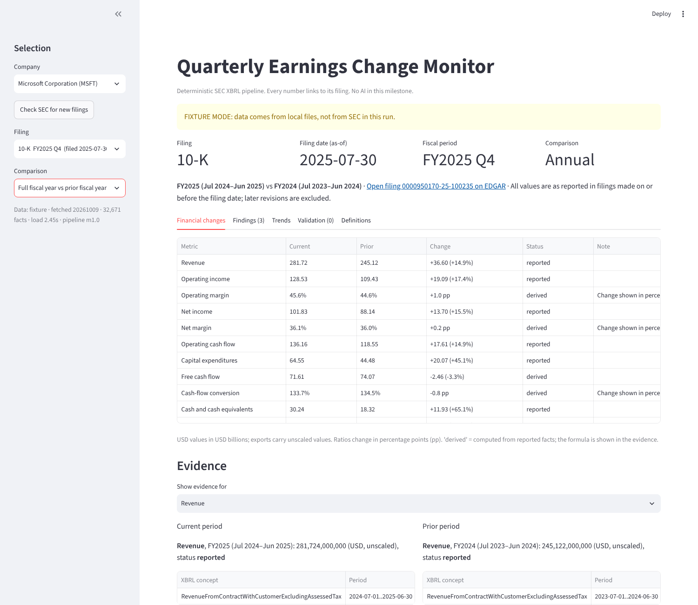

# Real-data verification: Microsoft FY2025

This is the acceptance check for milestone 1: does the pipeline pick the right numbers out
of Microsoft's real SEC filings? It was run on 2026-10-09 against the official SEC data,
downloaded the same day.

**Result: 200 of 200 comparisons pass. 8 rows (short-term debt) are outside the milestone 1
metrics and are reported as NOT COVERED, not as passes.** Verification also found three
real bugs, all fixed and covered by tests (section 6).

## 1. Fiscal year under test

Microsoft's fiscal year ends June 30. FY2025 runs July 1, 2024 to June 30, 2025.

| Filing | Form | Accession | Filed | Period end |
|---|---|---|---|---|
| FY2025 Q1 | 10-Q | 0000950170-24-118967 | 2024-10-30 | 2024-09-30 |
| FY2025 Q2 | 10-Q | 0000950170-25-010491 | 2025-01-29 | 2024-12-31 |
| FY2025 Q3 | 10-Q | 0000950170-25-061046 | 2025-04-30 | 2025-03-31 |
| FY2025 | 10-K | 0000950170-25-100235 | 2025-07-30 | 2025-06-30 |

The FY2024 Q1–Q3 10-Qs (0000950170-23-054855, 0000950170-24-008814, 0000950170-24-048288)
supply only the prior-year balance-sheet dates that FY2025 year-over-year comparisons show.

## 2. How the expected answers were built (independently)

`evaluation/msft_fy2025_reference.csv` (135 rows) was typed by reading the income
statement, balance sheet and cash-flow statement pages (EDGAR "R" pages R2/R4/R6) of the
filings above. Each row has the accession, period, line item, value in millions as printed,
and the URL of the page it was read from. **No code from this project produced those
numbers**, and the reconciliation never feeds pipeline output back into the expected column:
expected values come only from that CSV (derived expectations such as Q4 = FY − 9M or
margins are computed from CSV rows inside the reconciliation script, never from the
pipeline).

The reference is re-checked against the filings by `evaluation/verify_reference.py`, which
uses none of the pipeline's code. It downloads each cited page and the filing's main HTML
document from www.sec.gov, then:

1. finds the cited line item and period column on the R page and compares the printed
   number (135 of 135 match; capital expenditures are printed as a negative outflow and
   stored as a positive amount, as in XBRL);
2. checks that each value appears as printed in the filing's main 10-Q/10-K document
   (135 of 135 found).

It also checks the reference internally: total assets equal total liabilities and equity on
all 8 balance-sheet dates, and each three-month cash-flow column equals the difference of
the year-to-date columns.

What this does not prove: the R pages are SEC's rendering of the same XBRL that the
Company Facts API comes from, so a tagging error by Microsoft would appear in both. Check 2
(the human-readable filing document) guards against that for presence of each number, not
for its row and column.

## 3. The data the pipeline ran on

`tests/fixtures/real/` holds the unmodified responses from SEC's two APIs, gzip-compressed:

| File | Source URL | SHA-256 of the bytes SEC returned |
|---|---|---|
| `submissions/CIK0000789019.json.gz` | https://data.sec.gov/submissions/CIK0000789019.json | `2484a2a3…3139c` |
| `companyfacts/CIK0000789019.json.gz` | https://data.sec.gov/api/xbrl/companyfacts/CIK0000789019.json | `f8aae296…7246f` |

`manifest.json` records the full hashes, download time (2026-10-09T18:21:33Z) and the
User-Agent used. `tests/test_real_msft.py::test_fixture_files_match_manifest` re-checks
the hashes on every test run, so the cached files can't drift silently.

## 4. Tolerances

| Kind | Pass if | Why |
|---|---|---|
| USD amounts | \|actual − expected\| ≤ $500,000 | Statements print millions; XBRL stores whole dollars. Anything within half a million is the same printed number. |
| Ratios (margins, conversion) | \|actual − expected\| ≤ 0.0001 (0.01 pp) | Expected ratios are computed from the printed millions, so they carry rounding. |

A missing or "not meaningful" pipeline value always fails. Any source fact filed after the
analysis date also fails (look-ahead).

## 5. What was checked and the result

Run `python evaluation/reconcile_msft_fy2025.py`. It writes
`evaluation/MSFT_FY2025_reconciliation.xlsx` (sheets: Summary, Reconciliation, Provenance,
Reference checks, Export match, Reference dataset) and `evaluation/MSFT_FY2025_reconciliation.md`.

| Section | What it checks | Pass |
|---|---|---|
| Reported | Every reference line item (revenue, operating income, net income, operating cash flow, capex, cash, receivables, current and non-current deferred revenue, current and long-term debt, total assets, liabilities and equity), selected as of that filing's date | 127 / 127 |
| Displayed quarter | Standalone Q2 and Q3 values shown by the dashboard equal the statement's three-month column (and the YTD difference) | 10 / 10 |
| Derived Q4 | FY2025 Q4 and FY2024 Q4 = annual (10-K) − nine months (Q3 10-Q), for all five flow metrics | 10 / 10 |
| Derived measure | Free cash flow, operating margin, net margin and cash conversion for each FY2025 quarter, Q4 and both full years; total debt at each quarter end | 29 / 29 |
| Displayed prior instant | Prior-year balance-sheet values shown in year-over-year comparisons | 24 / 24 |
| Not covered | Short-term debt (commercial paper), outside milestone 1 metrics | 8 rows, not counted |

Selected FY2025 figures (USD millions, all PASS):

| | Q1 | Q2 | Q3 | Q4 (derived) | FY2025 |
|---|---|---|---|---|---|
| Revenue | 65,585 | 69,632 | 70,066 | 76,441 | 281,724 |
| Operating income | 30,552 | 31,653 | 32,000 | 34,323 | 128,528 |
| Net income | 24,667 | 24,108 | 25,824 | 27,233 | 101,832 |
| Operating cash flow | 34,180 | 22,291 | 37,044 | 42,647 | 136,162 |
| Capital expenditures | 14,923 | 15,804 | 16,745 | 17,079 | 64,551 |

Items from the request, one by one:

- **Units and signs.** All values are USD, whole dollars; capex is a positive outflow as on
  the statement; free cash flow = OCF − capex.
- **Reporting periods.** Every comparison matches exact start and end dates, never the
  `fy`/`fp` labels.
- **Consolidated vs segment.** Company Facts contains only non-dimensional (consolidated)
  facts; every selected source is the consolidated line item on R2/R4/R6.
- **Standalone quarterly cash flow and Q4.** Microsoft prints three-month cash-flow columns
  in its 10-Qs, so Q2 and Q3 cash flow are *reported*; the reconciliation also checks them
  against nine-month minus six-month figures. Q4 is *derived* (FY − 9M) and its two inputs
  are the 10-K and the Q3 10-Q, both shown with links.
- **Historical availability.** 247 source facts behind the reconciled values were checked:
  every one was filed on or before the date of the filing being analyzed (0 violations).
- **Amendments and revised figures.** See section 7: real cases exist in Microsoft's history
  and are now regression tests. FY2025 itself has no revised consolidated figures in later
  filings.
- **Dashboard and exports.** 205 values exported by the 10 FY2025 analyses (each filing ×
  each comparison) were matched to the reconciled values by metric and exact period: all
  equal, all with sources. `tests/test_dashboard_real.py` drives the Streamlit app on the
  real data, picks the FY2025 10-K annual comparison, and checks the rendered table.

### Demonstration: dashboard and export on the FY2025 10-K

The dashboard (fixture mode on the cached SEC data, FY2025 10-K, annual comparison) shows
revenue 281.72, operating income 128.53, net income 101.83, operating cash flow 136.16, capex
64.55 and free cash flow 71.61 (USD billions), matching the 10-K's statements.
`tests/test_dashboard_real.py` checks the same table automatically.

The Excel export of the same analysis (`earnings-monitor analyze MSFT --accn
0000950170-25-100235 --comparison annual --xlsx …`), Changes sheet, against the statements
(USD millions; the export stores whole dollars):

| Metric | FY2025 statement | FY2025 export | FY2024 statement | FY2024 export | Equal |
|---|---|---|---|---|---|
| Revenue | 281,724 | 281,724 | 245,122 | 245,122 | yes |
| Operating income | 128,528 | 128,528 | 109,433 | 109,433 | yes |
| Net income | 101,832 | 101,832 | 88,136 | 88,136 | yes |
| Operating cash flow | 136,162 | 136,162 | 118,548 | 118,548 | yes |
| Capital expenditures | 64,551 | 64,551 | 44,477 | 44,477 | yes |
| Cash and cash equivalents | 30,242 | 30,242 | 18,315 | 18,315 | yes |
| Current portion of long-term debt | 2,999 | 2,999 | 2,249 | 2,249 | yes |
| Long-term debt | 40,152 | 40,152 | 42,688 | 42,688 | yes |

Derived values carry their inputs and sources. For example, in the "Values and sources"
sheet FY2025 free cash flow is 71,611,000,000 with inputs "Operating cash flow =
136,162,000,000; Capital expenditures = 64,551,000,000". Both inputs list the 10-K
0000950170-25-100235 (filed 2025-07-30), the XBRL concept, the period and the EDGAR link.

## 6. Discrepancies found and fixed

1. **The export module was missing from the repository.** `.gitignore` had `exports/`,
   meant for output files, which also matched the source folder
   `src/earnings_monitor/exports/`. The code worked on the machine that built it but was
   never committed, so a fresh checkout could not run the CLI, dashboard or tests. Fixed by
   anchoring the rule to `/exports/` and restoring `exports/tables.py`.
2. **Filings before October 2020 could not be analyzed.** SEC's submissions file lists only
   the most recent filings; older ones come from the facts file, where the code took the
   period end as the latest date in the filing. That latest date was the cover-page share
   count (e.g. 2020-07-27), not the balance-sheet date (2020-06-30), so all 44 older 10-K/10-Qs
   failed with "not a known fiscal quarter end". Fixed by using only financial-statement
   (`us-gaap`) facts for the period end. Now all 68 Microsoft filings back to 2009 load.
3. **The reconciliation's dashboard/export check matched rows by label prefix**, which
   could pair a quarter with the full year ending the same day (41 false mismatches). It
   now matches by metric id and exact period dates and also checks the Changes sheet.

None of the FY2025 numbers were wrong; fixes 1 and 2 affected whether the app ran at all.

## 7. Revised figures and amendments (beyond FY2025)

**Terminology.** The app calls a value *revised* when a later filing reports a different
number for the same period. XBRL data does not say why. A retrospective adjustment for a new
accounting standard is not a correction of an error, so the app does not call either one
"corrected"; the reason has to be read from the filing. Both real cases below are
accounting-policy adoptions, not error corrections. In each, the filing describes the change
as adopting a new standard, and it does not mention an error.

- **ASC 606 adoption (FY2017 revenue).** The FY2017 Q1 10-Q (filed 2016-10-20) reported
  revenue of $20,453M. Microsoft early-adopted the FASB's new revenue standard (ASC 606) on
  July 1, 2017 "using the full retrospective method, which required us to restate each prior
  reporting period presented" (FY2018 Q1 10-Q, 0001564590-17-020171, under recently adopted accounting guidance). That 10-Q
  (filed 2017-10-26) shows the same quarter as $21,928M under the new standard. As of
  2016-10-20 the pipeline shows $20,453M; as of 2017-10-26 it shows $21,928M, marked
  revised, with the original value kept. The later number does not leak backwards.
- **Share-based payment standard adoption (FY2016 net income).** The FY2016 Q3 10-Q
  (0001193125-16-550254) describes the FASB's March 2016 standard on share-based payments
  (ASU 2016-09) under recently adopted guidance and says "We elected to early adopt the new guidance in the third
  quarter of fiscal year 2016 which requires us to reflect any adjustments as of July 1,
  2015" and shows Q1 and Q2 net income "As reported" and "As adjusted" (4,620 → 4,902 and
  4,998 → 5,018). The filing did not re-tag the six-month total, which remains 9,618 in the
  data. The displayed quarters are correct, and the YTD consistency check raises an error
  that nine months minus the (stale) six months does not equal the reported Q3. This is the
  intended behavior: the analyst sees the inconsistency instead of a silently mixed number.
- **Amendment.** For FY2012 Q2 the only XBRL source is the 10-Q/A filed 2012-01-27; the
  pipeline uses it and shows the form as 10-Q/A. Its values match later filings, so this
  case does not test an amendment that changes a number.

No real case of an error correction (a "restatement" in the accounting sense) was found in
Microsoft's data, so that path is covered only by synthetic tests.

## 8. Not supported or not verified

These are shown as *missing* in the app, never filled in or guessed.

| Gap | Effect | Status |
|---|---|---|
| Microsoft tagged operating cash flow as `NetCashProvidedByUsedInOperatingActivitiesContinuingOperations` in FY2014–FY2018 (instead of `NetCashProvidedByUsedInOperatingActivities`) | Operating cash flow, free cash flow and cash conversion are missing for those years | Not supported. The tag excludes discontinued operations, so adding it safely needs a check that discontinued operations are zero. Open decision. |
| Current portion of long-term debt not tagged with an approved concept, FY2009–FY2012 | Current debt and total debt missing for those years | Not supported |
| Short-term debt / commercial paper | Not part of "total debt" | Outside milestone 1 metrics (8 NOT COVERED rows) |
| Salesforce and Adobe | No real-data verification yet | Not verified (milestone 3) |
| Microsoft fiscal years other than FY2025 | Run without crashes (all 68 filings, 153 analyses), but values not checked against statements | Not verified |
| Error-correction restatements, number-changing amendments | Logic covered by synthetic tests only | Not verified on real data |

## 9. Speed

On the cloud test machine: first load of Microsoft's 32,671 facts ≈ 2 s; a reload of
unchanged data ≈ 0.9 s (skipped by hash); the full reconciliation ≈ 26 s; the whole test
suite (156 tests) ≈ 42 s; re-checking the reference against the filings ≈ 28 s. No API cost: SEC's APIs are free and only two requests are made.

## 10. Other notes

- The YTD-subtraction path for Q2/Q3 is exercised on real data only for Q4, because
  Microsoft prints three-month cash-flow columns; Q2/Q3 YTD subtraction is covered by
  synthetic tests.

---

# Milestone 3: Salesforce FY2026 and Adobe FY2025

Run on 2026-10-21 against SEC data downloaded the same day (hashes in
`tests/fixtures/real/manifest.json`).

**Result: Salesforce 422 of 422 checks pass; Adobe 452 of 452 pass (408 of 452 before the
Adobe debt fix below). All 466 non-zero reference figures are printed in the filings' main
documents.** Reproduce offline with `python evaluation/verification/reconcile.py CRM` (or
`ADBE`); `tests/test_real_crm_adbe.py` runs both in CI.

## Fiscal years under test

| Company | Fiscal year | Filings (accession, filed) |
|---|---|---|
| Salesforce (year ends Jan 31) | FY2026: Feb 1, 2025 to Jan 31, 2026 | 10-Qs 0001108524-25-000030 (2025-05-29), -25-000088 (2025-09-04), -25-000238 (2025-12-04); 10-K 0001108524-26-000060 (2026-03-02) |
| Adobe (52/53 weeks, ends Friday nearest Nov 30) | FY2025: Nov 30, 2024 to Nov 28, 2025 (52 weeks) | 10-Qs 0000796343-25-000059 (2025-03-26), -25-000073 (2025-06-25), -25-000107 (2025-09-24); 10-K 0000796343-26-000003 (2026-01-15) |

The prior fiscal year's three 10-Qs and 10-K are read too, because the year-over-year and
sequential comparisons of FY2026/FY2025 display them (for example the prior Q4, which
neither company files on its own: it is derived as fiscal year minus nine months).

## How the expected answers were built

This differs from Microsoft in one way, stated plainly: the Microsoft reference was typed by
hand; these two were **read by a script** from the same EDGAR statement pages, using printed
line labels that I chose after reading each statement (`evaluation/verification/companies.py`).

- `statements.py` reads each filing's `FilingSummary.xml`, finds the balance sheet, income
  statement and cash-flow statement pages, and parses every row: printed label, the XBRL
  concept EDGAR shows for that line, and the value in every column. It imports nothing from
  the pipeline and never reads the Company Facts API.
- `build_reference.py` picks each metric's line **by its printed label** (for example
  Adobe's "Debt" under current liabilities), not by XBRL concept, so the reference does not
  inherit the pipeline's concept choices. A line that is not printed (Salesforce shows no
  current debt in most quarters) produces no reference figure; zeros are never assumed.
- `check_documents.py` checks every non-zero figure appears, as printed, in the filing's
  main HTML document: 232/232 (Salesforce), 234/234 (Adobe).
- The reconciliation checks the balance-sheet identity in the reference: 16/16 dates each.

The same caveat as for Microsoft applies: the statement pages and the Company Facts API both
come from the company's XBRL, so a tagging error by the company would appear in both; the
document check guards against that only for whether each number is printed.

## What is checked

`evaluation/verification/reconcile.py`, generic for any company in `companies.py`:

1. **Reported**: every reference row (each line item, each column of each filing) against
   the value the pipeline selects for that exact period, as of that filing's date.
2. **Displayed**: every value every analysis (each comparison) of each FY filing shows:
   quarters (a printed 3-month column, or year-to-date differences, Q4 = FY − 9M), fiscal
   years, balance-sheet dates, and derived measures (free cash flow, margins, cash
   conversion, total debt) computed from reference figures only.
3. **Export**: each checked displayed value appears unchanged, with sources, in the Excel
   export's "Values and sources" sheet (186 Salesforce, 210 Adobe).

Tolerances as for Microsoft: USD within 500,000 (statements print millions), ratios within
0.0001. Displayed values with no reference figure are listed, not passed: 24 for Salesforce
(none for Adobe). Six are current debt in quarters where the balance sheet prints no
current-debt line (the pipeline shows 0, from a zero Salesforce tagged), six are total debt
on those dates (it needs current debt), and twelve are non-current unearned revenue, which
Salesforce does not report (shown as missing, not zero).

Outputs: `evaluation/verification/{CRM,ADBE}_reconciliation.md` and `.xlsx`.

## What verification found

1. **Adobe's debt tags.** Adobe tags the non-current "Debt" line of its balance sheet with
   `LongTermDebt`, a concept whose us-gaap definition includes the current portion, and
   tags the current "Debt" line with `DebtCurrent`. It also files `LongTermDebtCurrent`,
   which at Nov 29, 2024 is 1,500M while the balance sheet prints 1,499M. With the default
   concept lists, Adobe's long-term debt showed as missing and its current debt as 1,500M:
   44 failures. Fix: company-specific concept lists for Adobe only, each with its reason
   (`COMPANY_CONCEPTS` in `metrics.py`; the reason is included in every selection). The
   same concept means something else at Salesforce: its `LongTermDebt` is the total
   (14,439M = 4,000M current + 10,439M non-current at Jan 31, 2026), so the Adobe rule must
   not apply there; `tests/test_real_crm_adbe.py` checks both.
2. **Salesforce tags its current debt line `ConvertibleDebtCurrent`** on the FY2026
   balance sheet, while the pipeline uses `LongTermDebtCurrent`. The values are equal
   (4,000M), so these checks pass; the reconciliation lists the 10 rows where the
   statement's concept differs from the pipeline's.
3. **Adobe's 10-Qs print only year-to-date cash flows.** Quarterly operating cash flow and
   capital expenditures are derived (six months minus three months, and so on), and the
   derived values match the reference.
4. **Adobe's 52/53-week calendar** is handled: quarters end on Fridays (e.g. Feb 28, May 30,
   Aug 29, Nov 28, 2025) and the fiscal-year label is right (FY2024 Q1 ended Mar 1, 2024).
